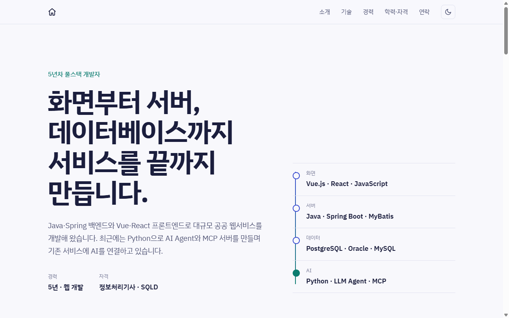
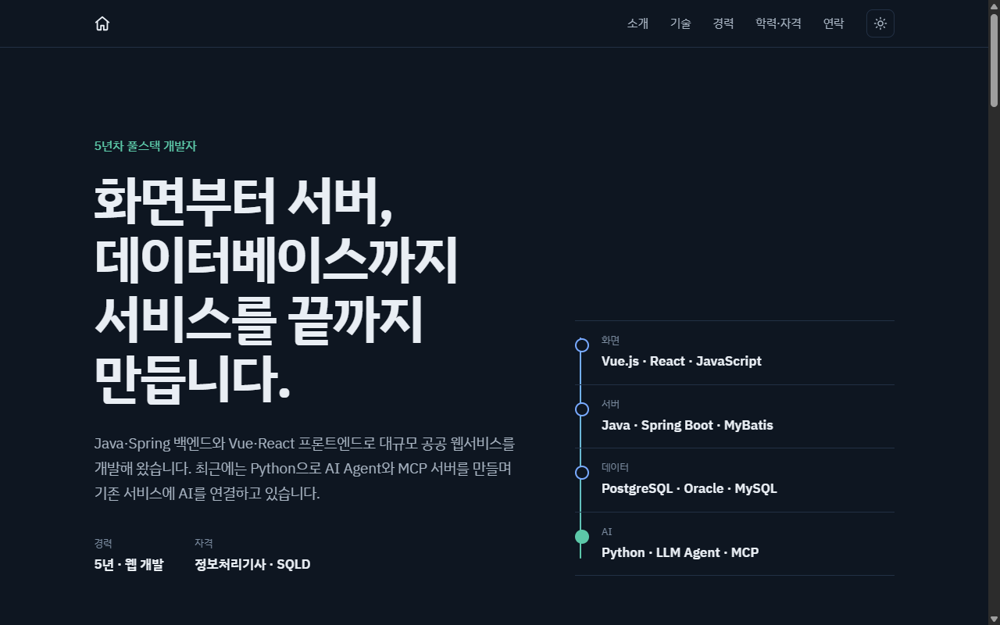

# 이선영 포트폴리오

화면부터 서버, 데이터베이스까지 서비스를 끝까지 만드는 5년차 풀스택 개발자 이선영의 포트폴리오 사이트입니다.

**🔗 https://young-27.github.io/**

| 라이트 모드 | 다크 모드 |
|---|---|
|  |  |

## 소개

- **경력**: 5년 · 웹 개발 (2021.11 – 현재)
- **주력 기술**: Java · Spring Boot · MyBatis / Vue.js · React · JavaScript / PostgreSQL · Oracle · MySQL
- **최근 작업**: Python 기반 LLM Agent · MCP 서버 개발 (AI 기반 통합인허가 사전진단 서비스)
- **자격증**: 정보처리기사, SQL개발자(SQLD), 컴퓨터활용능력 1급

## 주요 기능

- **스크롤 연동 효과**: 읽기 진행 막대, 섹션 등장 효과, 경력 타임라인 선 그리기, 현재 섹션 메뉴 표시, 숫자 카운트업
- **라이트 / 다크 모드**: 기기 설정을 자동으로 따르고, 상단 버튼으로 전환하면 선택이 저장됩니다.
- **반응형 레이아웃**: 데스크톱부터 모바일까지 대응합니다.
- **접근성**: `prefers-reduced-motion` 설정 시 모든 움직임을 끄고, 키보드 포커스를 표시합니다.

## 기술 스택

| 구분 | 내용 |
|---|---|
| 마크업 / 스타일 | HTML5, CSS3 (CSS 변수 기반 테마) |
| 인터랙션 | Vanilla JavaScript, IntersectionObserver |
| 애니메이션 | CSS Scroll-driven Animations (`animation-timeline`) + 미지원 브라우저용 JS 대체 |
| 폰트 | IBM Plex Sans KR (Google Fonts) |
| 배포 | GitHub Pages |

프레임워크나 빌드 도구 없이 `index.html` 한 파일로 구성했습니다.

## 구조

```
.
├── index.html     # 페이지 전체 (HTML + CSS + JS)
├── assets/        # README 미리보기 이미지
└── README.md
```

## 로컬에서 보기

별도 설치 없이 `index.html`을 브라우저로 열면 됩니다.

```bash
git clone https://github.com/Young-27/Young-27.github.io.git
cd Young-27.github.io
# index.html 을 브라우저로 열기
```

## 연락

- Email: dev.sylee95@gmail.com
- GitHub: [@Young-27](https://github.com/Young-27)
